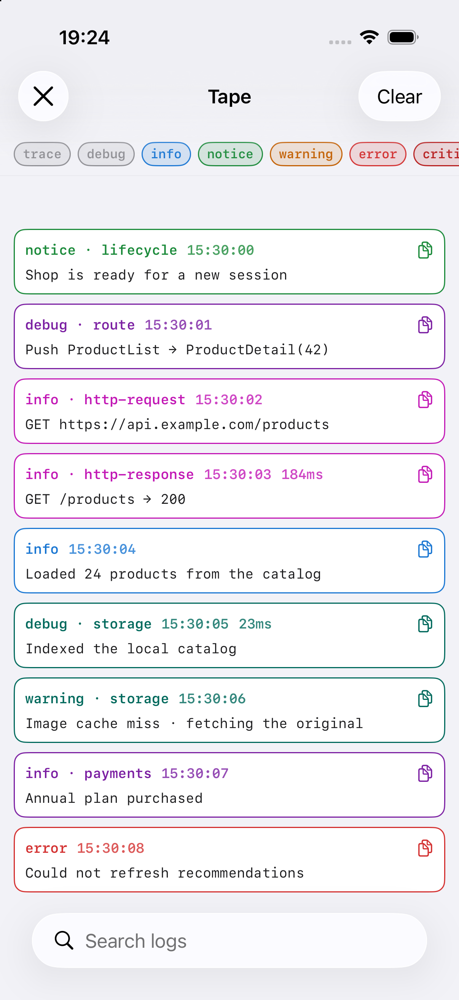
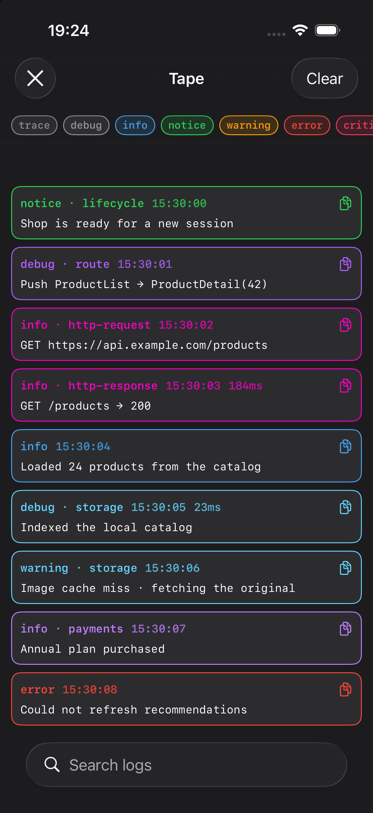
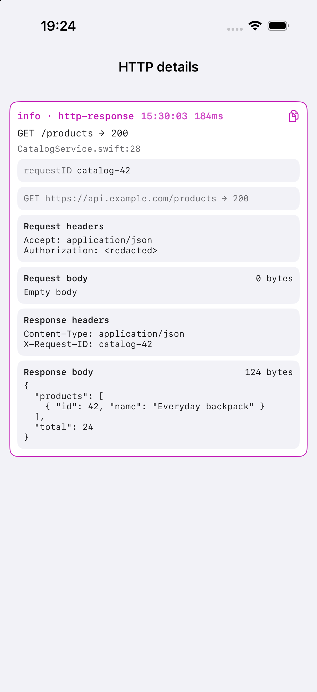

# TapeLogger

Structured logging and an in-app console for Swift.

Log from anywhere, then inspect entries in Xcode or directly in your app.
Inspect a decoding error, check a request's headers and JSON body, or see which
navigation event happened before an error—all in the same log history.

**Swift 6 · iOS 17+ · No third-party dependencies · MIT**

<table>
  <tr>
    <th>Console · Light</th>
    <th>Console · Dark</th>
    <th>HTTP details</th>
  </tr>
  <tr>
    <td></td>
    <td></td>
    <td></td>
  </tr>
</table>

*Console and expanded HTTP card from the demo, using sample data.*

```swift
import TapeLogger

Tape.debug("Cache hit", metadata: ["key": "feed", "items": 24])
Tape.warning("Retrying request", metadata: ["attempt": 2])
Tape.info("Database opened", key: .storage)
```

## Features

- **SwiftUI console:** text search, level filters, expandable entries and copy.
  Open it with a floating button, a device shake or your own debug menu.
- **Structured entries:** eight log levels, metadata, source locations, errors,
  stack traces and HTTP attachments.
- **URLSession logging:** request/response pairs with a shared ID, duration,
  sanitized headers and optional body previews. Opt in per session.
- **Navigation and lifecycle:** adapters for UIKit navigation, SwiftUI paths,
  app notifications and scene activity.
- **Measurements:** wrap sync or async code to record its duration alongside
  the log entry, without changing its return value or error handling.
- **Custom log types and themes:** define a category's level, metadata, color
  and badge once. The console supports light and dark appearances.

The core is UI-free and keeps a bounded in-memory history. Sinks forward
entries to console output or Apple's unified log; the UI and adapters are
separate products.

[Installation](#installation) · [Quick start](#quick-start) ·
[Examples](#examples) · [Guide](docs/Guide.md)

## Installation

Add TapeLogger with Swift Package Manager:

```swift
.package(url: "https://github.com/STlarner/TapeLogger.git", from: "0.10.0")
```

Choose the products your app needs:

| Product | Contents |
| --- | --- |
| `TapeLogger` | Structured logs, in-memory history, console output and unified logging |
| `TapeLoggerUI` | The searchable SwiftUI console and presentation triggers |
| `TapeLoggerAdapters` | Opt-in URLSession, UIKit navigation and app lifecycle events |

## Quick start

Add `TapeLogger` and `TapeLoggerUI` to your app target, then try this:

```swift
import Foundation
import SwiftUI
import TapeLogger
import TapeLoggerUI

@main
struct ExampleApp: App {
    init() {
        Tape.installRecommendedSinks(
            subsystem: Bundle.main.bundleIdentifier ?? "com.example.app"
        )
    }

    var body: some Scene {
        WindowGroup {
            Button("Generate logs") {
                Tape.debug("Cache hit", metadata: ["key": "feed"])
                Tape.warning("Retrying request", metadata: ["attempt": 2])
            }
            #if DEBUG
            .tapeConsole()
            #endif
        }
    }
}
```

Run the app and tap **Generate logs**. Tap the edge handle to reveal the
floating debug button, then tap it to open the console. The button can be
dragged or docked against either edge.

Recommended sinks choose console output for debugging and private unified
logging for Release. Your in-memory history is available independently.

## Examples

### Errors and metadata

Keep the message short and attach the underlying error and request context:

```swift
import Foundation
import TapeLogger

Tape.error(
    "Failed to decode response",
    error: DecodingError.dataCorrupted(.init(
        codingPath: [],
        debugDescription: "Expected an array at the root"
    )),
    metadata: ["endpoint": "/feed", "status": 200]
)
```

The expanded card shows the error, metadata and source location. Search for
`/feed` or the error text to find it again. Copy includes the attached details,
not just the message.

### Timing sync and async code

Wrap an operation with `measure`. You get its result as usual, plus a log entry
with the elapsed time—even if the operation throws.

```swift
import Foundation
import TapeLogger

func fetchData(from url: URL) async throws -> Data {
    let (data, _) = try await Tape.measure("Fetch data") {
        try await URLSession.shared.data(from: url)
    }
    return data
}
```

It works with synchronous code too, and async measurements preserve your
calling actor's isolation.

### URLSession logging

Configure a session once to log its requests and responses, including status,
duration, headers and optional body previews:

```swift
import Foundation
import TapeLoggerAdapters

@MainActor
final class DebugNetwork {
    let adapters = TapeAdapters()
    let session: URLSession

    init() throws {
        let network = TapeURLSessionAdapter(options: TapeNetworkOptions(
            allowedHosts: ["api.example.com"],
            logsBodies: true
        ))
        try adapters.install(network)

        let configuration = URLSessionConfiguration.default
        network.configure(configuration)
        session = URLSession(configuration: configuration)
    }

    func stop() {
        adapters.removeAll()
    }
}
```

Keep `DebugNetwork` alive while using its session; call `stop()` when finished.
Request and response entries share a request ID, so you can search for the
whole exchange. Body previews are opt-in and size-limited; sensitive headers
and common credential query parameters are redacted.

Use body previews with test data: body contents are not automatically
redacted. See the [network setup, privacy and request scope](docs/Guide.md#urlsession)
before connecting a session with custom transport or authentication needs.

### Navigation and lifecycle events

Observe a SwiftUI navigation path and scene activity:

```swift
import SwiftUI
import TapeLoggerUI

struct NavigationExample: View {
    @State private var path: [Int] = []

    var body: some View {
        NavigationStack(path: $path) {
            Button("Push detail") { path.append(1) }
                .navigationDestination(for: Int.self) { id in
                    Text("Detail \(id)")
                }
        }
        .tapeNavigation(path: $path, name: "main") { "Detail \($0)" }
        .tapeSceneLifecycle(name: "main")
    }
}
```

Pushes, pops, path resets and scene changes appear alongside your other logs.
UIKit apps can use the [navigation](docs/Guide.md#uikit-navigation) and
[app lifecycle](docs/Guide.md#ownership-and-app-lifecycle) adapters.

### Custom log types

Use `TapeLog` to define a category's defaults instead of repeating them at
every call site:

```swift
import TapeLogger

struct CacheLog: TapeLog {
    let message: String
    let cacheKey: String

    var title: String { "cache" }
    var level: TapeLevel { .debug }
    var color: TapeColor? {
        TapeColor(light: 0x00796B, dark: 0x64D2FF, ansi: 80, emoji: "💾")
    }
    var metadata: [String: TapeValue] {
        ["key": .string(cacheKey)]
    }
}

Tape.log(CacheLog(message: "Cache hit", cacheKey: "feed"))
```

Xcode output (cropped for display):

```text
┌──────────────────────────────────────────────────
│ 💾 debug · cache | 21:30:34.584
│ Cache hit
│ key=feed
└──────────────────────────────────────────────────
```

The same category color is used for the in-app card and terminal output.
`TapeTheme` can override category colors across destinations without changing
the log type or its call sites.

## Console presentation

| Trigger | Behavior |
| --- | --- |
| `.button` | Draggable, dockable floating button |
| `.shake` | Open with a physical-device shake gesture |
| `.none` | Present `TapeConsoleView()` from your own debug UI |

Pass the trigger to `.tapeConsole(trigger:)`. Keep the modifier inside
`#if DEBUG`, as in the quick start, when the console is for development only.

## Demo

Open **[Demo/TapeDemo.xcodeproj](Demo/TapeDemo.xcodeproj)** and run it.
Its five tabs cover **Logs**, **Network**, **SwiftUI**, **UIKit**, and
**Lifecycle**. Generate entries, send requests or change navigation state,
then inspect the resulting logs in the console.

The demo includes custom logs, measurements, live GET/POST requests, failures,
redaction, navigation changes and the movable console button. It's a local
example app, not an extra dependency in your project.

## Documentation

- [Configuration, themes and output destinations](docs/Guide.md)
- [Console delivery, flushing and unified-log privacy](docs/Guide.md#output-delivery-and-privacy-v0100)
- [Adapter setup and supported capture scope](docs/Guide.md#automatic-event-sources)
- [Build, test and refresh the screenshots](docs/Screenshots.md)
- [Roadmap](ROADMAP.md)

## License

[MIT](LICENSE)
